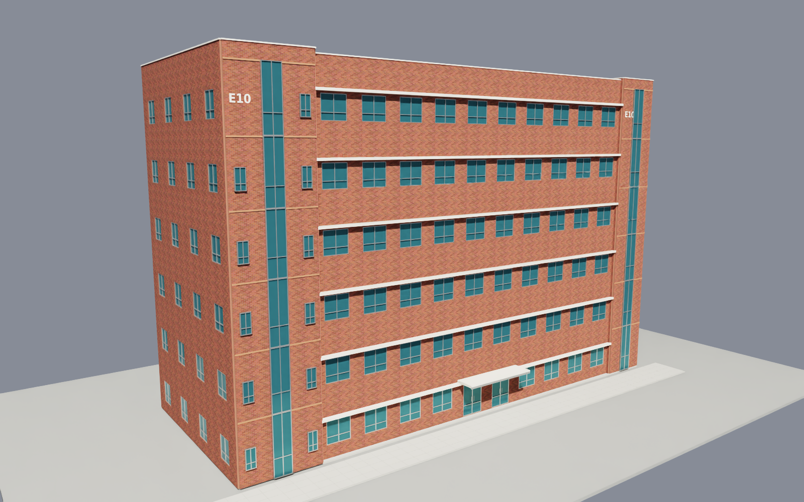

# CBNU E10 Isaac Sim 월드

`CBNU-E10.mp4`, 사용자 제공 치수, **충북대 공식 E10 외관 사진**으로 만든 월드다. 붉은 벽돌과 반복 창호를 갖춘 6층 외피 안에 영상의 3층 복도·계단을 배치했다. 촬영된 3층 바닥은 `z=0`이며, E9 저장소 없이 독립적으로 사용할 수 있다.

**[Isaac Sim에서 열 월드: cbnu_e10.usda](worlds/cbnu_e10/cbnu_e10.usda)**



## 열기

Isaac Sim의 `File > Open`에서 다음 파일을 연다.

```text
/home/a/Isaac_Worlds_CBNU_E10/worlds/cbnu_e10/cbnu_e10.usda
```

외관을 보는 기본 viewport와 미리보기 노출 설정으로 새 Isaac Sim 창을 열려면:

```bash
cd /home/a/Isaac_Worlds_CBNU_E10
bash scripts/open_world.sh
```

복도에서 시작하려면 `E10_VIEW=Corridor bash scripts/open_world.sh`를 사용한다. 이 환경변수는 미리보기 시점 데이터만 선택하며 저장 카메라를 추가하지 않는다.

설치 위치 기본값은 `/home/a/isaacsim`이다. 다른 설치는 `E10_ISAAC_ROOT` 환경변수로 지정한다. GUI 실행 스크립트의 실제 창 실행은 이번 검증에 포함하지 않았으며, 동일 Stage는 Isaac Sim 5.1.0의 headless viewport에서 열고 렌더링했다.

사용자 요청에 따라 **저장된 월드의 Camera prim은 0개**다. 미리보기 촬영 시점은 JSON에만 보관하고 촬영용 카메라는 저장하지 않는 session layer에서 임시로 만든다. GUI 실행 스크립트도 기본 viewport의 시점만 맞춘다.

[외피와 천장을 숨긴 실내 구조 확인용 Stage](worlds/cbnu_e10/cbnu_e10_overview.usda)도 제공한다. 구조 확인용 파일은 표시만 숨기므로 시뮬레이션에는 기본 월드를 사용한다. 이미 파일을 열어 두었다면 다시 열어 변경을 반영한다.

## 치수와 추정 범위

| 항목 | 값 | 근거 |
| --- | --- | --- |
| 복도 벽 사이 폭 | **2.10m** | 사용자 제공 |
| 복도 바닥–천장 높이 | **2.50m** | 사용자 제공 |
| 계단 한 경사 구간의 좌우 폭 | **1.50m** | 사용자 제공 |
| 단높이 | **0.16m** | 사용자 제공 약 16cm |
| 복도 전체 길이 | 38.40m | 영상 배치에 맞춘 모델 추정값; 실측·영상 측량값 아님 |
| 첫 상승 계단 | 13단 | 2–4초 영상에서 추정한 단수 |
| 디딤판 깊이 | 0.28m | 추정값 |
| 계단 도착참 높이 | 상승 +2.08m / 하강 −2.08m | 13 × 0.16m로 계산한 모델값 |
| 입구참·끝참 깊이 | 각 1.20m | 추정값 |
| 건물 외피 | 6층, 본체 약 38.8×15.5m | 공식 사진의 형상에 맞춘 추정 모델 |
| 층간 모듈 | 4.16m | 13단×16cm×2와 맞춘 모델링 가정, 실측 아님 |
| 1층 바닥 / 3층 바닥 / 본체 지붕 | −8.32m / 0m / +16.64m | 위 층간 모듈로 계산; 파라펫은 지붕 위에 추가 |

실측 제약과 추정값은 [layout.json](worlds/cbnu_e10/config/layout.json)의 `measured`, `estimated`로 분리했다. 문 간격·문 개수·화분 공간·엘리베이터 치수도 영상 기반 근사다. 전체 길이를 바꾸면 `doors`, `stairs`, `alcove_x_range` 등 절대 좌표도 함께 조정한다.

계단은 영상에서 확인되는 상승·하강 방향을 반영한 각 13단과 끝참까지만 만든다. 끝부분 계단실의 내부와 하강 구간의 가려진 부분은 시작 계단 치수를 재사용한 추정 형상이다. **다른 층의 복도·완전한 층간 계단·방 내부는 재현하지 않았다.** 3층 문 뒤에는 외피를 연결하는 바닥·천장·구획벽만 있으며 닫힌 문으로 구분된다.

## 공식 사진 기반 외관

[충북대 공식 캠퍼스 지도](https://chungbuk.ac.kr/english/selectWebCampusList.do?key=736)의 E10 항목이 연결하는 [건물 사진](https://chungbuk.ac.kr/DATA/campus/20240405022354947_F3Rt.jpg)을 확인했다. 해당 항목의 명칭은 `Electrical & Computer Engineering the 2nd Hall`이며, [로보틱스연구실 공식 홈페이지](https://robotics.cbnu.ac.kr/index.php)에서도 E10을 전자정보2관으로 표기한다.

복도 양옆을 건물 폭으로 연결하고 붉은 벽돌 외벽, 흰색 수평 띠장, 반복 창호, 단부 수직 유리창, 평지붕·파라펫·E10 표지와 출입구 캐노피를 추가했다. 기존 계단실과 화분 공간은 이 건물 외피 안에 들어간다. 원래의 복도·계단 치수와 실내 충돌 형상은 유지한다.

외관 치수와 사진에 보이지 않는 후면은 추정이다. 다른 층은 외관용 형상이며 실제 다층 주행 환경으로 검증한 것이 아니다. 외관 설정은 [exterior.json](worlds/cbnu_e10/config/exterior.json), 근거는 [외관 조사·구현 기록](docs/3_official_photo_exterior.md)에 있다.

## 영상에서 반영한 구성

- 긴 직선 복도, 흰 벽, 검정 걸레받이, 테라조 바닥과 녹색 테두리.
- 청록색·흰색 양개문과 세로 창, 끝부분의 유리 분할문, 출입 카드 리더와 방 표시판.
- 작은 원형 천장등, 천장 패널 줄눈, 감지기·배선, 소화기 13개와 소화전함.
- 시작 오른쪽 계단실과 반대편 왼쪽 계단실, 녹색 벽·금속 난간·석재 디딤판.
- 끝부분 오른쪽의 화분 6개·정수기·창문 공간, 목재 마감 엘리베이터와 점자 블록.
- 복도 양 끝 창과 실내측 금속 가드, E10 3F 안내판과 정숙 표지.

소품과 재질은 단순화한 절차적 형상이다. 방 이름이나 안내판의 판독되지 않은 문구는 복제하지 않았다. 유리는 불투명한 반사 재질로 표현했고 문·엘리베이터는 정적이다. 식물의 잎은 시각 형상이며 화분과 줄기에 충돌이 있다.

문짝 32개의 창에는 실제 개구부가 있다. 유리는 문 표면보다 **35.5mm**, 창틀은 **9.5mm** 들어가며 유리 뒤를 막는 문짝 면을 제거했다. 큰 유리문 분할대도 안쪽에 들어간다. [문 창문 음각 변경](docs/4_recessed_door_windows.md)

화분은 잎 끝까지 벽면에서 최소 8cm 여유를 두었고, 창틀·가드·엘리베이터 마감·소화전도 안쪽으로 정렬했다. 소품의 실제 형상 316개에 대해 복도와 화분 공간 내부 경계를 검사하여 벽 밖 돌출 0개를 확인했다. [정리 기록](docs/2_camera_removal_fixture_containment.md)

| 실제 Isaac Sim 미리보기 | 파일 |
| --- | --- |
| 전체 건물 정면 | [ExteriorFront.png](outputs/preview/ExteriorFront.png) |
| 전체 건물 후면 | [ExteriorRear.png](outputs/preview/ExteriorRear.png) |
| 직선 복도 | [Corridor.png](outputs/preview/Corridor.png) |
| 문 창문 음각 근접 | [DoorRecess.png](outputs/preview/DoorRecess.png) |
| 시작 계단 | [StartStairs.png](outputs/preview/StartStairs.png) |
| 반대편 계단·엘리베이터 앞 | [FarLobby.png](outputs/preview/FarLobby.png) |
| 화분 공간 | [PlantAlcove.png](outputs/preview/PlantAlcove.png) |
| 돌아보는 복도 | [Return.png](outputs/preview/Return.png) |
| 천장을 숨긴 전체 구조 | [Overview.png](outputs/preview/Overview.png) |

## 물리와 좌표

단위는 미터, 위쪽은 Z, 복도 진행 방향은 +X다. 영상 시작에서 앞을 보면 왼쪽이 +Y, 오른쪽이 −Y다. 중력은 −Z 방향 9.81m/s²이며 바닥·벽·천장·문·계단·난간·주요 소품은 정적 collider를 갖는다. 계단실 바닥을 통짜 평면으로 덮지 않아 하강 구간이 실제로 열린다.

복도 2.10m는 벽면 기준이며 걸레받이·손잡이·소화기 등은 벽 앞에 돌출된다. 중앙 **폭 1.30m, z=0.15–2.00m** 범위의 통행 공간과 계단 중심선 위 2m 여유를 검사했다.

`/World/SpawnPoints`는 로봇을 배치할 기준 Xform이며 로봇 자체는 포함하지 않는다.

| Spawn | 위치 (x, y, z), m | 방향 |
| --- | --- | --- |
| CorridorStart | (4.4, 0, 0.55) | +X |
| CorridorReturn | (31.0, 0, 0.55) | −X |
| StartStairApproach | (3.24, −1.65, 0.55) | −Y |
| FarStairApproach | (35.16, 1.65, 0.55) | +Y |

0.55m는 로봇 기준점의 예시 높이이므로 실제 로봇의 초기 자세에 맞춰 조정한다.

## 재생성과 검증

```bash
python3 -B scripts/make_textures.py
bash scripts/usd_python.sh scripts/build_world.py
bash scripts/usd_python.sh scripts/validate_world.py
bash scripts/render_headless.sh
```

텍스처 생성에는 시스템 Python의 NumPy·Pillow, USD 생성·정적 검사에는 Isaac Sim에 포함된 OpenUSD를 사용한다. Isaac Sim을 실행하는 마지막 명령은 GPU가 필요하며 미리보기와 PhysX 검사 결과를 갱신한다. 생성된 USD를 직접 고치면 재생성 때 덮어써지므로 치수는 JSON, 형상은 생성 스크립트에서 수정한다.

2026-11-09 KST 확인:

- USD 합성, 4개 제공 치수, 52개 디딤판과 끝참, 통행 공간, 계단 머리 위 여유, 재질·상대경로 의존성, 카메라 제거·소품 경계·문 음각·외피: **정적 검사 74개 PASS**.
- Isaac Sim 실제 Stage 렌더: **9개 시점 저장**.
- 복도·화분 공간 및 양 계단 상승/하강의 1·7·13단: **구체 낙하 14개 + PhysX raycast 14개 PASS**.
- **Go2 보행·계단 등반 정책은 실행하지 않았다.** 위 검증은 월드 형상과 물리 지지면에 대한 확인이다.

근거: [정적 검사 JSON](outputs/validation/static_validation.json), [렌더·PhysX 검사 JSON](outputs/preview/capture_status.json), [소품 경계 검사 JSON](outputs/validation/containment_validation.json), [생성 manifest](worlds/cbnu_e10/build_manifest.json). 정적·PhysX 보고서에는 검사한 Stage의 SHA-256을 기록한다. 런타임 로그는 `outputs/runtime/isaac_capture.log`에 저장된다.

## 근거와 변경 기록

- [영상 검토 및 구현 기록](docs/1_cbnu_e10_world.md)
- [카메라 제거와 소품 정렬](docs/2_camera_removal_fixture_containment.md)
- [공식 사진 기반 외관](docs/3_official_photo_exterior.md) · [문 창문 음각](docs/4_recessed_door_windows.md)
- [원본 영상](/home/a/Downloads/CBNU-E10.mp4): 81.60초, 저장 해상도 1920×1080 / 회전 적용 표시 1080×1920, 평균 약 29.97fps.
- [2초 간격 추출 프레임](reference): 총 41개. `python3 -B scripts/extract_reference.py`로 재생성한다.
- 원본 영상은 다운로드 폴더에 보존하며 저장소·Obsidian에 복사하지 않았다.

`worlds/`와 `assets/`를 함께 유지하면 E9 저장소 없이 사용할 수 있다.
